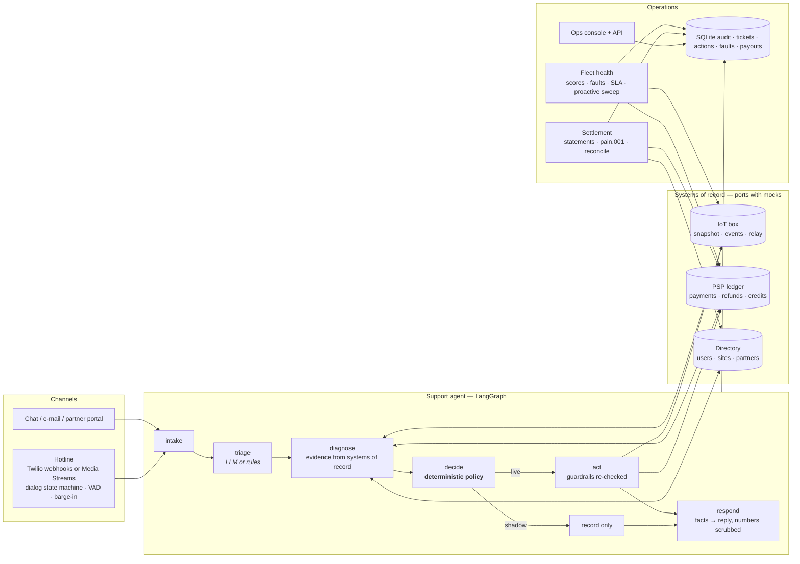

# laundry-ops-autopilot

**Autonomous support & remediation (chat, e-mail and a voice hotline), predictive fleet health and partner settlement for shared-laundry operators** — built for the WeWash / Bosch-BSH operating model (retrofit IoT box, €2–4 cycles, Mollie-style payments, revenue share with building operators), portable to any shared-appliance, EV-charging or micro-mobility fleet.

[](https://github.com/manojrevenkar12-web/laundry-ops-autopilot/actions)

```
$ laundryops eval --n 500 --gate
deflection=89.6% (ceiling 89.6%) outcome_acc=100.0% intent_acc=100.0% wrong_refund=0.00% unsafe=0.00% p95=3ms  gate=PASS
```

---

## The problem it removes

A shared-laundry operator's support queue is dominated by a handful of low-value, high-volume cases: *the door stayed locked after I paid*, *the cycle died halfway*, *I was charged twice*, *where is my refund*, plus building operators asking *where is our payout*. Each one costs a human 5–10 minutes of checking box telemetry, the payment ledger and the booking — to resolve a €3.50 problem. Public reviews of operators in this space are full of exactly these complaints, and of refunds that took a week.

This repository is a working platform that resolves those cases **end-to-end, in milliseconds, without a human, and without the LLM ever touching money or hardware**.

## What it does

| Module | What happens | Human needed? |
|---|---|---|
| **Support & remediation agent** | Resident writes in any language (chat, email). The agent triages, pulls the *evidence* (box snapshot + events, payment ledger, booking), decides by deterministic policy, then **re-triggers the relay**, **refunds the exact ledger amount**, **credits a reservation conflict**, **opens a fault ticket for the building manager**, or hands over — and replies in the resident's language. | No, for ~85–90 % of the mix |
| **Voice hotline** | The same brain answers the phone. Caller is identified by number, language is detected from the first sentence and the recogniser follows it, spoken machine numbers ("Maschine drei") resolve, the relay is re-triggered **while the caller is on the line** and the agent asks *"Is the door open now?"* — if not, it refunds and opens the fault ticket on the spot, justified by our own failed actuation on record. Silence, DTMF fallback, barge-in, warm transfer to a human with a whispered summary, SMS when identity can't be verified, every call logged with transcript and outcome. Twilio speech webhooks (day one) or a real-time Media Streams pipeline (μ-law, VAD, STT/TTS ports). | No, for ~88 % of calls in the eval |
| **Fleet health & dispatch** | Scores every machine from telemetry (offline minutes, relay failures, abort rate, ticket pressure), opens de-duplicated fault tickets with **ack / fix SLA clocks**, escalates breaches, and runs a **proactive sweep**: failed paid sessions the box already knows about are refunded *before* the resident writes in. Residents with upcoming bookings on a dead machine are told, and pointed to a working one. | No |
| **Partner settlement** | Monthly statements per partner (gross, refunds, net, share), **SEPA pain.001.001.09** payout files, IBAN mod-97 validation, reconciliation of bank returns, and a self-service "where is our share?" answer the support agent serves instantly with the end-to-end reference. | No |

## Why an in-house team would not have built it this way

1. **The model never decides money or hardware.** Triage (intent, language, machine reference) is the only thing the LLM does before a decision, and the reply is the only thing it does after. The decision is `laundryops/support/policy.py`: plain code, deterministic, reason-coded, unit-tested. The resident's claim steers *where we look*; it never authorises anything.
2. **Evidence beats text.** A refund needs a duplicate capture, an orphan capture or a cycle the box says failed. Amounts always come from the ledger entry being refunded, never from the message. "Refund me 99 EUR" refunds €3.50 if that is what the ledger says.
3. **Hard caps, re-checked at execution time.** Per-refund ceiling, per-user 30-day count and total, goodwill-credit cap, relay actuation only on a fresh paid session on a healthy box — and the executor re-reads the box and the ledger immediately before acting. Idempotency keys make retries safe.
4. **Shadow mode.** Run it on the live ticket stream for two weeks: it decides, logs the decision and the reply it *would* have sent, executes nothing. The ops lead compares against what agents actually did before a single cent moves.
5. **Reply guardrail.** Any number in a model-written reply that is not in the approved facts is stripped; if the reply is mostly invented, the deterministic template is sent instead.
6. **Prompt-injection and legal/damage routing.** Instruction-like content, legal threats and damage claims always go to a person, before any evidence is even looked at.
7. **Voice without a second brain.** The hotline is a dialog state machine over the same pipeline — not a separate bot with its own prompts. Hand-offs carry the caller, the intent, the evidence and what was already done to the human agent's ear before the call is bridged.
8. **A labelled eval with a CI gate.** 500 scenarios × 5 languages × 20 failure kinds with ground truth for intent, outcome, action and refund amount. `wrong_refund_rate` and `unsafe_action_rate` must be 0.0 or the build fails. A text-noise run (accents dropped, typos, filler) is reported alongside.
9. **An audit trail an auditor can read.** Every ticket carries the triage, the evidence summary, the reason codes, every action with its evidence, and a timestamped actor log (`llm`, `policy`, `executor`, `fleet`, `settlement`).

## Architecture



The agent is a LangGraph `StateGraph` (`laundryops/support/graph.py`): `intake → triage → diagnose → decide → act|shadow → respond`. `laundryops graph` prints it as Mermaid.

## Safety contract (what the agent may do on its own)

| Action | Precondition (all must hold) | Bound |
|---|---|---|
| Re-trigger relay | paid session ≤ 20 min old · box online · relay not engaged · < 5 W draw · no other session running · < 2 relay failures on that box in 7 d | 1 retry, then refund + fault ticket |
| Refund | duplicate capture **or** orphan capture **or** box-reported failure (abort / offline / relay fault / suspect relay) · payment belongs to the identified resident | amount = ledger balance of that payment · ≤ €10 · ≤ 3 refunds and ≤ €20 per resident / 30 d · idempotent per ticket+payment |
| Goodwill credit | reservation held, box shows another session running | €1.50 · 1 per resident / 30 d |
| Open fault ticket | machine resolvable | de-duplicated per machine; severity by signal; building manager notified |
| Hand over to human | injection · legal/abuse · damage · no identity · no evidence · any cap hit | always; the reply says why in the resident's language |
| Refund after a voice "door still locked" | our own relay re-trigger for this session is in the audit store (≤ 15 min) **and** the caller confirms failure | same refund bounds; without the actuation on record the caller's word moves nothing |

Everything in the right-hand column is configuration (`laundryops/config.py`, `LOPS_*` env), nothing is a prompt.

## Evaluation

`evals/report.md` is regenerated by `laundryops eval` and gated in CI.

| 500 scenarios, seed 42 | chat, clean text | chat, text noise p=0.5 | **voice hotline** (spoken numbers, no punctuation) | voice + noise p=0.4 |
|---|---|---|---|---|
| Deflection / containment (no human) | **89.6 %** (policy ceiling for this mix 89.6 %) | 89.0 % | **89.6 %** | 88.6 % |
| Outcome accuracy | 100 % | 99.4 % | 100 % | 99.0 % |
| Intent accuracy | 100 % | 98.4 % | 100 % | 98.2 % |
| Wrong-refund rate | **0.00 %** | **0.00 %** | **0.00 %** | **0.00 %** |
| Unsafe-action rate | **0.00 %** | **0.00 %** | **0.00 %** | **0.00 %** |
| Escalation recall | 100 % | 100 % | 100 % | 100 % |
| Caller turns per call | — | — | 2.04 | 2.04 |

Reports: `evals/report.md`, `evals/report_noisy.md`, `evals/report_voice.md`, `evals/report_voice_noisy.md`.

Scenario mix (weights in `laundryops/synth/world.py`): door-locked with healthy relay / faulty relay / offline box, aborted cycle, duplicate capture, double-charge claim with a single capture, orphan charge, refund-status with and without a refund on file, reservation conflict, app/login questions, general questions, machine reports, damage claims, legal threats, partner payout questions, unverifiable claims, repeat refunders over the cap, prompt injection, and residents who think a running machine is broken. Languages: DE 45 %, EN 30 %, TR 10 %, FR 8 %, ES 7 %.

**Read these numbers honestly.** The data is synthetic: the phrasings and the failure distribution are designed, and the offline rules classifier was built against that phrasebook, so *intent accuracy* here is a floor for the live model, not a forecast for a real ticket stream. What the eval does prove is the thing that matters for a buyer: *given* a triage, the policy issues the right action with the right amount every time, and when triage degrades (the noisy run, other seeds) the failure mode is a human hand-over, never a wrong refund. Deflection on a real stream is measured in shadow mode on the operator's own tickets — that is the pilot.

## Quick start

```bash
pip install -e ".[dev]"
laundryops demo            # one ticket of every kind, full trace: triage → evidence → decision → actions → reply
laundryops eval --gate     # 500 labelled tickets, writes evals/report.md, exit 1 if the gate fails
laundryops eval --channel voice   # the same 500 scenarios as phone calls through the hotline dialog
laundryops serve           # API + ops console at http://127.0.0.1:8000/console  (POST /demo/seed first)
pytest -q                  # 46 tests: policy, guardrails, triage, replies, fleet, SEPA, voice, API, eval gate
```

Live model triage/replies (OpenRouter, OpenAI-compatible):

```bash
cp .env.example .env
LOPS_LLM_MODE=openrouter LOPS_OPENROUTER_API_KEY=sk-or-... laundryops eval --llm openrouter
```

Offline fallback stays on by default: if the provider is down or returns malformed JSON, the rules engine takes over and the audit trail records which one triaged the ticket.

Docker: `docker compose up --build`, then `curl -X POST localhost:8000/demo/seed` and open `/console`.

### Try the hotline

* **In the browser (no keys):** open `/console`, pick a resident under *Hotline demo*, press *Call the hotline* and talk (Chrome/Edge use the Web Speech API; elsewhere type what the caller says). The transcript shows what the agent did, the SMS it sent and the whisper a human would hear on transfer.
* **On a real phone number (Twilio):** set `LOPS_VOICE_PUBLIC_BASE_URL` to your public URL, point the number's voice webhook at `POST /voice/incoming`, set `LOPS_VOICE_HUMAN_NUMBER` for transfers and `LOPS_VOICE_SMS_FROM` for texts. Twilio does the speech recognition per turn with the language and hints the dialog returns.
* **Real-time (Twilio Media Streams):** `<Connect><Stream url="wss://…/voice/stream">` with `from` as a custom parameter; set `LOPS_STT_PROVIDER=deepgram` + `LOPS_DEEPGRAM_API_KEY` and `LOPS_TTS_PROVIDER=elevenlabs` + `LOPS_ELEVENLABS_API_KEY` / `LOPS_ELEVENLABS_VOICE_ID`. Without keys the pipeline runs with scripted STT and tone TTS, which is how the tests exercise VAD, end-pointing and barge-in.

## API (FastAPI, `/docs` for OpenAPI)

| | |
|---|---|
| `POST /tickets` | handle one message → triage, decision, actions, reply, evidence summary |
| `GET /tickets/{id}` | full record + audit trail |
| `GET /metrics` | deflection, refunds, relay re-triggers, open faults, p50 |
| `GET /fleet/health` · `POST /fleet/dispatch` · `POST /fleet/proactive` · `POST /fleet/faults/{id}/ack\|fix` · `POST /fleet/outage/{machine}/notify` | fleet module |
| `POST /settlement/run` · `GET /settlement/partners/{id}` · `GET /settlement/sepa` · `POST /settlement/reconcile` | settlement module |
| `POST /voice/incoming` · `POST /voice/turn` · `GET /voice/whisper` · `WS /voice/stream` | Twilio voice webhooks, warm-transfer whisper, Media Streams |
| `POST /voice/demo/start` · `POST /voice/demo/turn` · `GET /voice/calls` | browser hotline demo + call log / containment metrics |
| `POST /demo/seed?n=120` · `GET /console` | seeded demo + ops console |

## Repository

```
laundryops/
  config.py                 every money/hardware bound, env-overridable
  domain/models.py          pydantic domain model (cents, UTC)
  adapters/                 ports + mocks: iot (WeWash-box-style), payments (Mollie-style), directory, notifier
  llm/                      offline rules triage · OpenRouter client (JSON-validated, retry, fallback, number scrubber) · prompts
  support/                  diagnose (evidence) · policy (decision) · actions (guardrailed executor) · templates (5 languages) · graph (LangGraph) · service
  fleet/service.py          health scoring · dispatch + SLA · proactive sweep · outage notifications
  settlement/               statements · pain.001.001.09 · IBAN · reconciliation · partner status
  voice/                    dialog state machine · spoken numbers · voice reply shaping · TwiML · μ-law + VAD · STT/TTS ports · Media Streams session
  synth/                    deterministic world + labelled multilingual scenarios
  evaluation.py             metrics, noise perturbation, CI gate, report writer
  api/                      FastAPI app + single-file ops console
  cli.py                    eval · serve · demo · graph
evals/                      committed reports (clean + noisy) and the labelled set with every reply
tests/                      46 tests
sales/                      pitch, ROI model, outreach, demo script
```

## Integrating with a real operator

The agent only talks to three ports: `TelemetryPort`, `PaymentPort`, `Directory`. For WeWash that means one adapter each for the box backend (snapshot, event log, relay command), Mollie (payments, refunds with idempotency keys) and the app's user/site/partner data. The helpdesk (Zendesk, Freshdesk, Intercom) stays where it is: tickets are posted to `/tickets` from a webhook and the reply is written back as the agent's answer or as a drafted note in shadow mode. Sensible pilot shape: **two weeks shadow on the live stream → read the eval on real tickets → switch on auto-resolution per intent, lowest-risk first (info, relay re-trigger), refunds last**.

## Known limits

* Mocks stand in for the box backend, the PSP and the app directory; the schemas are plausible, not WeWash's.
* The rules triage handles the five eval languages; the live model handles any language.
* Voice: the Twilio-webhook path recognises speech in the language the dialog last detected; a caller who switches language mid-sentence is better served by the Media Streams path with a multilingual STT. The Deepgram/ElevenLabs clients are thin and not exercised in CI.
* Replies are template-grade in offline mode; the live model writes better prose from the same facts.
* Settlement covers EUR SEPA credit transfers only (no SEPA direct debit, no multi-currency).
* No auth on the API (a pilot deployment sits behind the operator's SSO / gateway).

MIT © 2026 Manoj Kumar P
